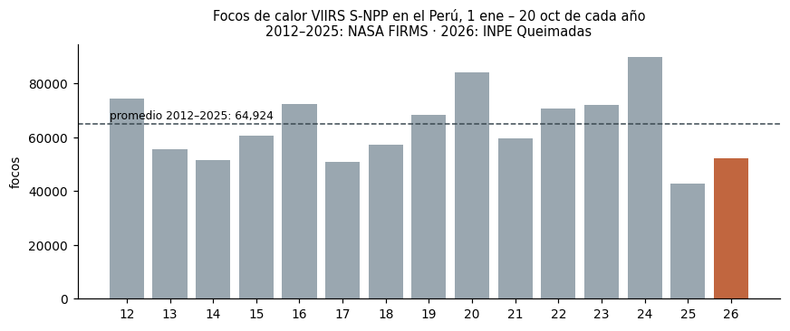
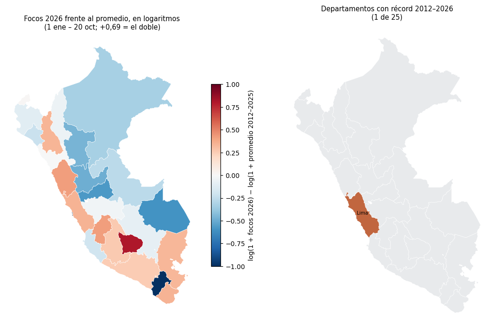

# Incendios en el Perú 2026: ¿año récord?

**Pregunta (reto E).** ¿Fue 2026 un año récord de focos de calor en el Perú, y en qué
departamentos? Para el mínimo de la tarea medimos además el área quemada del **incendio de
Río Tambo (Satipo, Junín)** con dNBR de Sentinel-2.

Todo está en [`incendios_2026.ipynb`](incendios_2026.ipynb) (su fuente legible es
`incendios_2026.py`).

## Datos y fechas

| Dato | Fuente | Fechas | Tipo |
|---|---|---|---|
| Focos VIIRS S-NPP | NASA FIRMS, archivo anual «viirs-snpp Peru» | 2012–2025 | puntos |
| Focos VIIRS S-NPP (NPP-375 y NPP-375D) | INPE Queimadas, CSV mensual Sudamérica | 1 ene – 20 oct 2026 | puntos |
| Focos últimos 7 días (para calibrar) | NASA FIRMS «South America 7d» | 14–20 oct 2026 | puntos |
| Límites de departamentos y distritos | INEI, `juaneladio/peru-geojson` | — | polígonos |
| Sentinel-2 L2A (B04, B08, B12, SCL) | Microsoft Planetary Computer | 23 sep, 8 oct y 13 oct 2026 | raster 20 m |

FIRMS todavía no publica sin clave el archivo anual de 2026; por eso 2026 viene de INPE.

## Método

1. **Comparación igual con igual.** Cada año se cuenta del 1 de enero al 20 de octubre, solo
   con el satélite S-NPP, y los focos se asignan a departamentos con un cruce espacial.
2. **Calibración.** En los 7 días que cubren ambas fuentes, INPE cuenta **12 % más** focos que
   FIRMS (3 750 frente a 3 347). Los resultados de 2026 se reportan en bruto y corregidos.
3. **Logaritmos.** Los cambios por departamento se miden como
   `log(1 + focos 2026) − log(1 + promedio 2012–2025)`: suaviza los extremos y hace simétricas
   las subidas y las bajadas (+0,69 es el doble; −0,69, la mitad).
4. **dNBR en Río Tambo.** `NBR = (B08 − B12) / (B08 + B12)` y `dNBR = NBR antes − NBR después`,
   en un recuadro de ~30 × 29 km alrededor del grupo de focos de octubre.
   - Las fechas se eligieron por la nubosidad **dentro de la zona** (capa SCL), no por la de la
     escena entera: antes **23 sep** (6,9 %), después **8 oct** (2,3 %) y **13 oct** (30 %).
     Ver la galería `figuras/candidatas.html`.
   - Se enmascaran nubes, sombras, agua y nieve (SCL 0, 1, 3, 6, 8, 9, 10 y 11).
   - Severidad según USGS: ≥0,27 moderada-baja, ≥0,44 moderada-alta, ≥0,66 alta.
   - **Sembrado con focos:** solo cuentan las manchas con dNBR ≥ 0,27 que tienen un foco VIIRS
     de octubre a 500 m o menos, para descartar cosechas, derrumbes o ríos que cambian de cauce.

## Hallazgos

1. **En el acumulado del año, 2026 no es récord.** Del 1 de enero al 20 de octubre hubo
   52 324 focos, **19 % menos** que el promedio 2012–2025 (puesto 12 de 15). El máximo es
   2024, con 89 942.
2. **Octubre sí es excepcional, pero el récord no es seguro.** Del 1 al 20 de octubre hubo
   13 809 focos, **+97 %** sobre el promedio. Eso supera a 2020 (12 967) en bruto, pero al
   corregir la diferencia de 12 % entre INPE y FIRMS queda en ~12 325: un empate técnico con 2020.
3. **Solo Lima bate su récord departamental** (736 focos frente a un máximo previo de 630), y lo
   mantiene tras la corrección. Apurímac duplica su promedio (+124 %), pero sin llegar a récord.
4. **Río Tambo:** entre el 23 de septiembre y el 8 de octubre se quemaron **711 ha** (dNBR ≥ 0,27,
   sembrado con focos). Al 13 de octubre van **al menos 1 609 ha**, de las cuales 1 561 ha están
   dentro del distrito de Río Tambo. Esta cifra es un piso, porque el 33 % de la zona no tiene
   dato válido.





## Limitaciones

- **Un foco de calor no es un incendio.** Un incendio grande produce muchos focos, y una
  quema agrícola pequeña también produce focos.
- **Las nubes esconden el fuego.** VIIRS no ve debajo de las nubes, así que un año más nublado
  tiene menos focos. Sentinel-2 tampoco ve: el 13 de octubre falta un tercio de la zona.
- **El humo.** La imagen del 8 de octubre tiene humo sobre el incendio que la SCL no marca
  como nube. Por eso esa fecha subestima el área quemada.
- **El cambio de fuente.** La corrección de 12 % sale de solo 7 días y varía mucho entre días
  (+6 % a +28 %).
- En 2026 no se pueden quitar las fuentes fijas y los volcanes (INPE no los marca). En
  2012–2025 son el 2,3 % de los focos.
- El umbral de dNBR y la regla de sembrado son decisiones de método: el área de «toda la zona»
  sin sembrar da 1 185 ha al 8 de octubre.

## Reproducir

```bash
python3 -m venv .venv && .venv/bin/pip install -r requirements.txt
./descargar_datos.sh          # ~870 MB, todo público y sin clave
.venv/bin/jupyter nbconvert --to notebook --execute incendios_2026.ipynb
```
