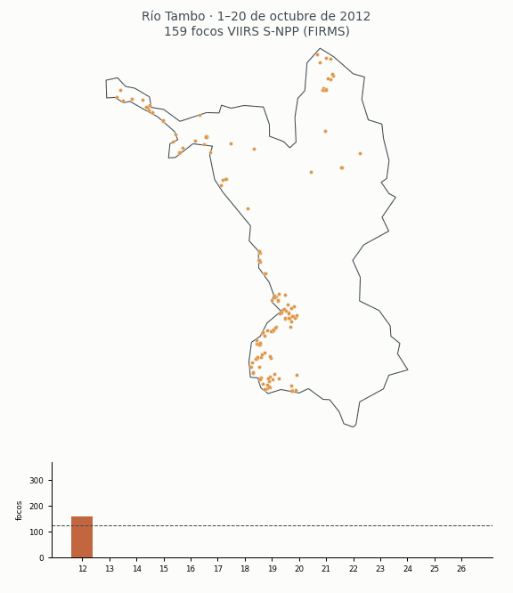
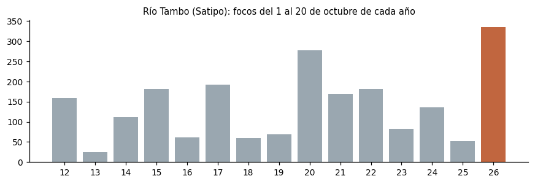
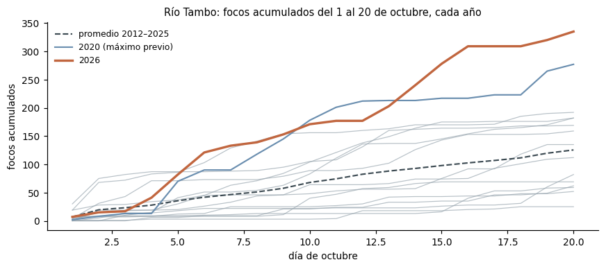
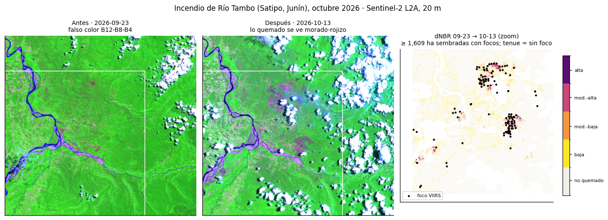

# Río Tambo en llamas: ¿octubre de 2026 es el peor de su historia?

**Pregunta (reto E).** ¿Fue octubre de 2026 el peor octubre de focos de calor del **distrito de
Río Tambo (Satipo, Junín)** desde 2012? Y, para el mínimo de la tarea, ¿cuánto quemó su
incendio principal según el dNBR de Sentinel-2?



Todo está en [`incendios_2026.ipynb`](incendios_2026.ipynb) (su fuente legible es
`incendios_2026.py`).

## Datos y fechas

| Dato | Fuente | Fechas | Tipo |
|---|---|---|---|
| Focos VIIRS S-NPP | NASA FIRMS, archivo anual «viirs-snpp Peru» | 2012–2025 | puntos |
| Focos VIIRS S-NPP (NPP-375 y NPP-375D) | INPE Queimadas, CSV mensual Sudamérica | 1 ene – 20 oct 2026 | puntos |
| Focos últimos 7 días (para calibrar) | NASA FIRMS «South America 7d» | 14–20 oct 2026 | puntos |
| Límites de departamentos y distritos | INEI, `juaneladio/peru-geojson` | — | polígonos |
| Sentinel-2 L2A (B04, B08, B12, SCL) | Microsoft Planetary Computer | 23 sep, 8 oct y 13 oct 2026 | raster 20 m |

FIRMS todavía no publica sin clave el archivo anual de 2026; por eso 2026 viene de INPE.

## Método

1. **El mismo distrito a través del tiempo.** Con los límites del INEI se cuentan los focos
   S-NPP dentro de Río Tambo, siempre en la **misma ventana: del 1 al 20 de octubre** de cada
   año (2026 llega hasta el 20).
2. **Calibración.** En los 7 días que cubren ambas fuentes, INPE cuenta **12 % más** focos que
   FIRMS (3 750 frente a 3 347). El dato de 2026 se reporta en bruto y corregido.
3. **Comparación con su propia historia.** 2026 se compara con el promedio y el máximo de los
   octubres 2012–2025 del distrito, usando `log(1 + focos 2026) − log(1 + promedio)` (el log
   suaviza; +0,69 es el doble). Además se acumulan los focos día a día para ver cuándo se
   despegó 2026.
4. **dNBR en Río Tambo.** `NBR = (B08 − B12) / (B08 + B12)` y `dNBR = NBR antes − NBR después`,
   en un recuadro de ~30 × 29 km alrededor del grupo de focos de octubre.
   - Las fechas se eligieron por la nubosidad **dentro de la zona** (capa SCL), no por la de la
     escena entera: antes **23 sep** (6,9 %), después **8 oct** (2,3 %) y **13 oct** (30 %).
     Ver la galería `figuras/candidatas.html`.
   - Se enmascaran nubes, sombras, agua y nieve (SCL 0, 1, 3, 6, 8, 9, 10 y 11).
   - Severidad según USGS: ≥0,27 moderada-baja, ≥0,44 moderada-alta, ≥0,66 alta.
   - **Sembrado con focos:** solo cuentan las manchas con dNBR ≥ 0,27 que tienen un foco VIIRS
     de octubre a 500 m o menos, para descartar cosechas, derrumbes o ríos que cambian de cauce.

## Hallazgos

1. **Octubre de 2026 es el peor octubre de Río Tambo desde 2012.** Del 1 al 20 de octubre hubo
   **335 focos**, ≈ **2,7 veces** el promedio de 2012–2025 (126; log_dif +0,98). Ocupa el
   puesto 1 de 15.
2. **El récord resiste la calibración.** El máximo previo era 277 focos, en 2020. Aun quitando
   el 12 % que INPE cuenta de más frente a FIRMS, 2026 queda en **~299 focos** y sigue siendo récord.
3. **El despegue fue el 4 de octubre.** Desde ese día 2026 ya no baja del promedio, y desde
   el 14 supera también a 2020. Solo entre el 4 y el 6 de octubre se concentró el **31 %** de
   los focos del mes.
4. **Su incendio principal**, medido con dNBR, quemó **711 ha** entre el 23 de septiembre y el
   8 de octubre (dNBR ≥ 0,27, sembrado con focos). Al 13 de octubre van **al menos 1 609 ha**,
   de las cuales 1 561 ha están dentro del distrito. Esta cifra es un piso, porque el 33 % de
   la zona no tiene dato válido.





## Limitaciones

- **Un foco de calor no es un incendio.** Un incendio grande produce muchos focos, y una
  quema agrícola pequeña también produce focos.
- **Las nubes esconden el fuego.** VIIRS no ve debajo de las nubes, así que un año más nublado
  tiene menos focos. Sentinel-2 tampoco ve: el 13 de octubre falta un tercio de la zona.
- **El humo.** La imagen del 8 de octubre tiene humo sobre el incendio que la SCL no marca
  como nube. Por eso esa fecha subestima el área quemada.
- **El cambio de fuente.** La corrección de 12 % sale de solo 7 días y varía mucho entre días
  (+6 % a +28 %).
- En 2026 no se pueden quitar las fuentes fijas y los volcanes (INPE no los marca). En los octubres
  2012–2025 de Río Tambo son solo el 0,2 % de los focos.
- Río Tambo mide más de 10 000 km²: un octubre con más focos puede venir de varios incendios
  distintos, no de uno solo. La animación muestra dónde cayeron.
- El umbral de dNBR y la regla de sembrado son decisiones de método: el área de «toda la zona»
  sin sembrar da 1 185 ha al 8 de octubre.

## Reproducir

```bash
python3 -m venv .venv && .venv/bin/pip install -r requirements.txt
./descargar_datos.sh          # ~870 MB, todo público y sin clave
.venv/bin/jupyter nbconvert --to notebook --execute incendios_2026.ipynb
```

## Mapa interactivo

La página tiene cuatro mapas interactivos y una sección de metodología al final:

1. **Focos año a año** (1–20 de octubre, 2012–2026).
2. **Lluvia y focos** (Open-Meteo, ERA5 de 0,25°, 1–15 de octubre de cada año). 2026 es el octubre más seco de
   la serie: 80 mm frente a 123 mm de promedio. En los 15 años, la correlación entre la lluvia y log(1 + focos) es **−0,82**.
3. **Lluvia diaria y focos de los últimos 7 días** (lluvia horaria de Open-Meteo sumada por día, más focos FIRMS 7d),
   con un botón por día y otro para la semana completa. Los dos días más secos (14 y 15 de octubre, ~3 mm) tuvieron 31 y
   33 focos. Tras las lluvias del 16 al 18, los focos cayeron a cero el 17 y el 18.
4. **Sentinel-2 con lluvia y focos de los últimos 7 días**: un mosaico sin nubes de Sentinel-2 L2A (sep–oct 2026,
   ~220 m), en color real o falso color, con la lluvia del día en celdas azules y los focos encima. El **98 %** de los
   focos de la semana está bajo 1 000 m (Copernicus DEM), aunque solo el 46 % del distrito está a esa altura.

`clima.py` descarga la lluvia, `web/exportar_relieve.py` el relieve, `web/exportar_sentinel.py` el mosaico Sentinel-2, y `web/exportar_clima.py` los prepara para la página.

`web/index.html` es una página autónoma: ábrela en el navegador y recorre los octubres de 2012 a 2026 con el control de año o el botón «Reproducir». Se regenera con los datos de `web/datos.js` sobre `web/plantilla.html`.
