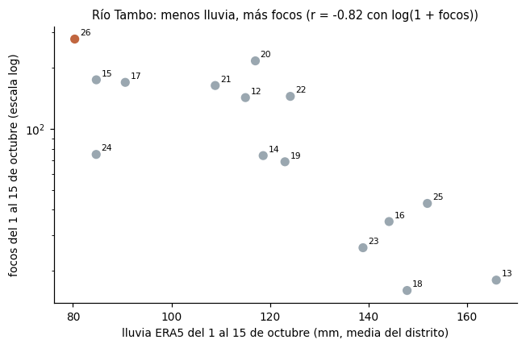
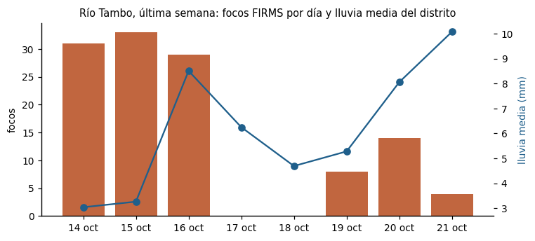
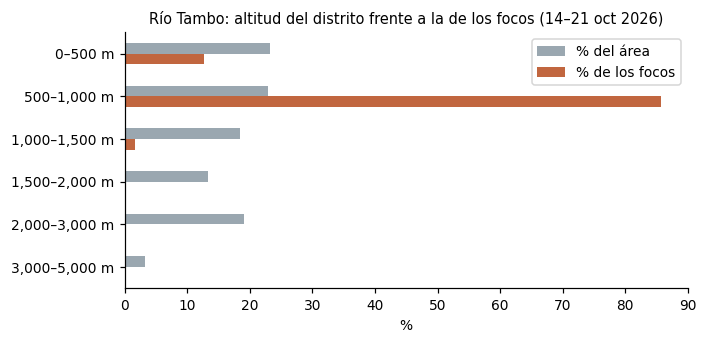

# Río Tambo en llamas: ¿octubre de 2026 es el peor de su historia?

**Reto E · ¿Año récord?, aplicado a un distrito.** Curso de Python Intermedio · Sesión «Incendios en el Perú, vistos desde el
espacio» · 21 de octubre de 2026.

Este trabajo compara el **distrito de Río Tambo (Satipo, Junín)** consigo mismo: sus focos de calor del 1 al 20 de octubre de
2026 frente a los mismos días de 2012–2025. Luego busca por qué fue así, con la lluvia, y dónde ocurre el fuego, con Sentinel-2
y el relieve. Para el mínimo de la tarea, mide el área quemada de su incendio principal con dNBR.

- **Página web (pública):** https://haradaoyakawahideki.github.io/Python/
- **Notebook:** [`incendios_2026.ipynb`](incendios_2026.ipynb) (su fuente legible es `incendios_2026.py`)


---

## 1. Respuesta

**Sí.** Octubre de 2026 es el peor octubre de Río Tambo desde 2012, y el récord resiste la corrección por el cambio de
fuente de datos. Hay dos factores que lo acompañan:

- **La lluvia:** es el octubre más seco de la serie.
- **El terreno:** el fuego se concentra en los valles bajos.

## 2. Hallazgos

| # | Hallazgo | Cifra clave |
|---|---|---|
| 1 | Del 1 al 20 de octubre de 2026 hubo **335 focos** VIIRS S-NPP en Río Tambo, frente a un promedio de 126 en 2012–2025. Es el puesto 1 de 15. | **×2,7** su promedio |
| 2 | El máximo previo fue 277 focos, en 2020. Corregido por la diferencia entre INPE y FIRMS (+12 %), 2026 queda en ~299 y sigue siendo récord. El despegue fue el **4 de octubre**: solo del 4 al 6 se concentró el 31 % de los focos del mes. | **299** corregido > 277 |
| 3 | Es el **octubre más seco** de la serie: 80 mm del 1 al 15 de octubre (ERA5), frente a un promedio de 123 mm. En los 15 años, la lluvia y log(1 + focos) correlacionan en **−0,82**. | **r = −0,82** |
| 4 | En la última semana, los días secos del 14 y 15 de octubre tuvieron 31 y 33 focos. Tras las lluvias, el 17 y el 18 no hubo ninguno. | **0** focos tras llover |
| 5 | El fuego está en los valles: el **98 %** de los focos de la semana está bajo 1 000 m, aunque solo el 46 % del distrito está a esa altura. Altitud mediana: 637 m en los focos y 1 101 m en el distrito. | **98 %** frente a 46 % |
| 6 | El incendio principal (−11,87°, −73,86°) quemó **711 ha** entre el 23 de septiembre y el 8 de octubre según el dNBR. Al 13 de octubre van **al menos 1 609 ha**, de las cuales 1 561 están dentro del distrito. | **≥ 1 609 ha** |

<table>
<tr>
<td width="50%"></td>
<td width="50%"></td>
</tr>
<tr>
<td width="50%"></td>
<td width="50%"></td>
</tr>
</table>


---

## 3. Datos y fechas

Todas las fuentes son públicas, no piden clave ni pago y corren en CPU.

| Dato | Fuente | Tipo | Cobertura usada |
|---|---|---|---|
| Focos 2012–2025 | NASA FIRMS, archivo anual `viirs-snpp_<año>_Peru.csv` | Puntos | 1–20 de octubre de cada año |
| Focos 2026 | INPE Queimadas, CSV mensual de Sudamérica, satélites NPP-375 y NPP-375D | Puntos | 1 ene – 20 oct 2026 |
| Focos últimos 7 días | NASA FIRMS `SUOMI_VIIRS_C2_South_America_7d.csv` | Puntos | 14–21 oct 2026 (y calibración) |
| Límites | INEI, `juaneladio/peru-geojson` (departamental y distrital) | Polígonos | — |
| Imagen y área quemada | Sentinel-2 L2A, Microsoft Planetary Computer | **Ráster** 20 m | 23 sep, 8 oct y 13 oct 2026 |
| Mosaico del distrito | Sentinel-2 L2A, mediana sin nubes de 78 escenas | **Ráster** ~220 m | 1 sep – 20 oct 2026 |
| Lluvia por año | Open-Meteo, reanálisis ERA5 | **Ráster** 0,25° | 1–15 de octubre, 2012–2026 |
| Lluvia diaria | Open-Meteo, mejor modelo disponible | **Ráster** 0,15° | 14–21 oct 2026, horaria |
| Relieve | Copernicus DEM GLO-90, Planetary Computer | **Ráster** 90 m | — |

FIRMS todavía no publica sin clave el archivo anual de 2026, así que ese año se toma de INPE, que distribuye datos del mismo sensor.

## 4. Metodología

### 4.1. Flujo

El notebook sigue el mismo orden que la página web:

| Sección | Qué hace |
|---|---|
| 1 · Datos | Une FIRMS 2012–2025 e INPE 2026 y asigna cada foco a su departamento. |
| 2 · Calibración | Compara INPE con FIRMS 7d en los mismos días: INPE cuenta 12 % más (3 750 frente a 3 347). |
| 3 · Octubres | Cuenta los focos dentro de Río Tambo del 1 al 20 de octubre de cada año, el acumulado día a día y el mapa animado. |
| 4 · dNBR | Elige imágenes por la nube dentro de la zona, calcula NBR y dNBR, aplica la máscara SCL y obtiene hectáreas por severidad y por distrito. |
| 5 · Lluvia por año | Lluvia ERA5 del 1 al 15 de octubre frente a los focos de la misma ventana, y su correlación. |
| 6 · Última semana | Lluvia diaria y focos FIRMS del 14 al 21 de octubre. |
| 7 · Territorio | Mosaico Sentinel-2 (`web/exportar_sentinel.py`) y altitud de los focos frente a la del distrito (Copernicus DEM). |
| 8 · Web | `web/exportar_clima.py`, `web/exportar_relieve.py` y `web/construir_web.py` generan `docs/index.html`. |
| 9 · Hallazgos | Los textos con cifras se arman solos a partir de los resultados. |

### 4.2. Decisiones

1. **El distrito contra sí mismo.** Comparar distritos entre sí premiaría a los más grandes y amazónicos. Aquí la pregunta es
   si a Río Tambo le fue peor que en sus propios octubres.
2. **Misma ventana cada año.** Se toman los focos del 1 al 20 de octubre, porque 2026 llega hasta el 20. Comparar años completos
   mezclaría temporadas distintas.
3. **Un solo sensor.** Solo se usa VIIRS S-NPP, el único con datos desde 2012. Sumar NOAA-20 y NOAA-21 inflaría los años recientes.
4. **Calibración explícita.** El valor de 2026 se reporta en bruto y corregido por el +12 % de INPE frente a FIRMS.
5. **Logaritmos.** `log(1 + focos)` suaviza los años extremos (+0,69 es el doble).
6. **Lluvia hasta el 15 de octubre.** ERA5 aún no cubre los días siguientes de 2026, y la versión que llega al 20 mezcla otro
   modelo con lluvias muy distintas. Por eso la ventana es la misma para todos los años y para los focos de esa comparación.
7. **dNBR sembrado con focos.** Solo cuentan las manchas con dNBR ≥ 0,27 que tienen un foco VIIRS a 500 m o menos. Las fechas
   se eligieron por la nube *dentro de la zona*, medida con la capa SCL (ver `figuras/candidatas.html`).

## 5. Limitaciones

- **Un foco de calor no es un incendio.** Un incendio grande produce muchos focos, y una quema agrícola también produce focos.
- **Las nubes esconden el fuego.** Los días de lluvia pierden focos por dos vías: hay menos fuego y además el satélite ve menos.
- **La correlación no prueba causalidad.** ERA5, con celdas de unos 27 km, suaviza la lluvia en zonas de montaña, y siete días
  son pocos para sacar conclusiones generales.
- **La relación diaria es débil.** En la última semana, la correlación entre la lluvia y log(1 + focos) es −0,05. El corte
  del 14 al 18 de octubre se ve, pero no es lineal: el 20 llovió y aun así hubo 14 focos.
- **La corrección del cambio de fuente es aproximada.** Sale de solo 7 días y varía entre +6 % y +28 % según el día.
- **El dNBR del 13 de octubre es un piso.** El 33 % de la zona estaba bajo nubes. La imagen del 8 de octubre tiene humo, que la
  capa SCL no marca.

## 6. Reproducir

```bash
python3 -m venv .venv && .venv/bin/pip install -r requirements.txt
./descargar_datos.sh                       # focos y límites (~870 MB)
.venv/bin/python clima.py                  # lluvia ERA5 y diaria (Open-Meteo)
.venv/bin/python web/exportar_sentinel.py  # mosaico Sentinel-2 (varios minutos)
.venv/bin/jupyter nbconvert --to notebook --execute incendios_2026.ipynb   # análisis + web
```

## 7. Estructura

```
Ejercicio/
├── incendios_2026.ipynb / .py   análisis completo (secciones 1–9)
├── descargar_datos.sh, clima.py descargas
├── figuras/                     figuras del README y galería de imágenes candidatas
└── web/                         plantilla.html + exportadores → index.html
docs/index.html                  página publicada con GitHub Pages
```
